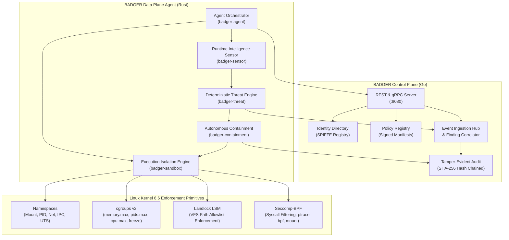

# BADGER Architecture Specification

**Version:** 1.0.0  
**Status:** Approved  
**Classification:** Core System Architecture

---

## 1. Architectural Philosophy

BADGER is designed on the foundational premise that **autonomous software agents are untrusted untamed software**. Merely operating within a private virtual network or container does not guarantee that an agent will not succumb to prompt injection, model drift, capability abuse, or malicious manipulation.

To provide genuine containment, BADGER decouples security authority from the agent runtime:
1. **Host-Enforced Boundaries:** Enforcement occurs via Linux kernel primitives outside the agent's memory space and process tree.
2. **Deterministic Rules:** Security findings rely on explainable kernel intercepts, not generative LLM evaluations.
3. **Fail-Safe & Observable:** If telemetry is degraded or interrupted, the system transitions to an explicit `Degraded` or `Unprotected` state rather than silently assuming protection.

---

## 2. High-Level Component Diagram

---

## 3. Data Flow

1. **Workload Registration:**
   The control plane receives a registration request for an autonomous workload. It issues a cryptographic identity (`spiffe://badger.local/ns/{tenant}/workload/{id}`) and associates it with a verified Capability Policy.

2. **Sandbox Initialization:**
   `badger-sandbox` creates a new cgroup v2 subtree (`/sys/fs/cgroup/badger/{workload_id}`), writes strict resource limits, and sets up namespace flags.

3. **Pre-Exec Enforcement:**
   In the child process fork before `execve`:
   - `unshare()` creates isolated Mount, PID, Network, IPC, and UTS namespaces.
   - `prctl(PR_SET_NO_NEW_PRIVS)` locks privilege escalation.
   - `landlock_restrict_self()` restricts filesystem rights directly within kernel VFS.
   - `seccomp()` installs BPF instructions denying forbidden syscalls (`SYS_ptrace`, `SYS_bpf`, `SYS_mount`).
   - Linux capabilities are dropped.

4. **Telemetry Observation:**
   `badger-sensor` captures execution, filesystem, and socket activity. Each event is decorated with workload identity, process ID, parent process ID, and sensor provenance.

5. **Detection & Containment:**
   If a blocked operation is detected, `badger-threat` generates a typed finding (`SecurityFinding`). If the finding severity warrants, `badger-containment` freezes the cgroup (`cgroup.freeze = 1`), revokes credentials, or sends `SIGKILL` with `ESRCH` verification.

6. **Audit Chaining:**
   Every enforcement outcome is hashed and chained into the immutable audit sequence using SHA-256 forward links.
