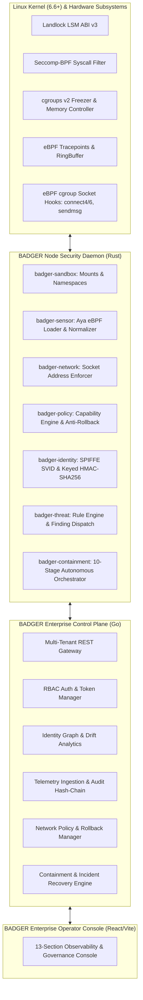

# BADGER Enterprise System Architecture

## 1. Executive Architecture Overview

**BADGER** (Autonomous Agent Security and Runtime Containment Infrastructure) is an enterprise-grade defense-in-depth platform specifically architected to govern, monitor, isolate, and contain autonomous AI agents and machine workloads running on Linux environments.

The platform marries kernel-level Mandatory Access Control (LSM) and tracepoint telemetry with higher-level machine identity intelligence, explainable capability governance, and automated response orchestration.

---

## 2. Layered Subsystems

### 2.1 Workload Sandboxing & Confinement (`badger-sandbox`)
- **Landlock LSM ABI v3**: Path-based filesystem restriction enforcing read-only system roots and read-write workspace trees. Blocks path traversal, symlink spoofing, and hardlink exploits at the VFS layer.
- **Seccomp-BPF**: Architecture-specific syscall filter (x86_64 and aarch64) blocking unauthorized privilege escalation (`setuid`, `setgid`, `ptrace`, `chroot`, `mount`, `reboot`, `bpf`).
- **Linux Namespaces**: Dedicated PID, mount, IPC, UTS, and network namespaces isolating workloads from host process tables and abstract Unix sockets.
- **cgroups v2**: Resource limits (memory limits, CPU quotas, max PID bounds) and atomic freeze control via `cgroup.freeze`.

### 2.2 Native eBPF Runtime Intelligence (`badger-sensor`)
- **Aya eBPF Framework**: Non-intrusive kernel tracepoint probes (`sched_process_exec`, `sched_process_exit`, `sched_process_fork`, `sys_enter_connect`, `sys_enter_openat`, `sys_enter_setuid`).
- **Kernel Ring Buffer**: Low-latency, high-throughput asynchronous delivery with backpressure monitoring and zero-copy user-space ring reading.
- **Workload Attribution**: Deterministic attribution using cgroup v2 inode IDs and task credentials, guaranteeing telemetry authenticity without relying on mutable `/proc` metadata.

### 2.3 Granular Network Egress Enforcement (`badger-network`)
- **cgroup Socket Hooks**: Real kernel enforcement via `cgroup/connect4`, `cgroup/connect6`, and `cgroup/sendmsg4` BPF programs attached to workload cgroup hierarchies.
- **Cloud Metadata Protection**: Mandatory kernel-level drops for `169.254.169.254` (AWS, GCP, Azure, OpenStack IMDS) and private loopback rebinding targets.
- **Network Policy Distribution**: Cryptographically signed network rulesets with monotonic version validation and instantaneous local rollback.

### 2.4 Machine Identity Intelligence (`badger-identity`)
- **Canonical Model**: First-class tracking of Tenants, Principals, Workloads, Credentials, Resources, and Relationships.
- **Keyed HMAC-SHA256 Fingerprinting**: Zero storage of raw tokens, API keys, or certificates. Identity connectors detect credential leakage, sharing across workloads, and privilege drift.
- **SPIFFE / SPIRE Workload Authority**: Automated issuance of X.509 SVIDs bound to host cgroups and process namespaces, with automatic 50% lifetime rotation and CRL revocation.
- **Graph & Effective Access**: Direct and transitive permission traversal across typed edges (`OWNS`, `RUNS_AS`, `USES_CREDENTIAL`, `CAN_ACCESS`, `DELEGATES_TO`).

### 2.5 Capability Governance & Policy Intelligence (`badger-policy`)
- **12 Strongly-Typed Capabilities**: `FsRead`, `FsWrite`, `ProcessExec`, `NetConnect`, `ContainerManage`, `DbAccess`, `ApiAccess`, `CredentialUse`, `DeploymentOp`, `PrivilegeChange`, `ResourceLimit`, `Delegation`.
- **Algebraic Subsumption & Intersection**: Mathematical verification that requested capabilities do not exceed assigned scopes. Subagent delegations strictly enforce capability intersections (`Delegated = Parent ∩ Child`).
- **Anti-Rollback Protection**: Stored monotonic versions prevent downgrade attacks. Signed policy distribution validates HMAC-SHA256 signatures before atomic deployment to disk caches.
- **Least Privilege Engine**: Evidence-based recommendation engine comparing observed eBPF telemetry with granted capabilities to generate tightened policies and simulation diffs.

### 2.6 Autonomous Containment & Incident Response (`badger-containment`)
- **10 Verifiable Response Actions**: `SuspendWorkload` (cgroup freeze), `FreezeCgroup`, `KillProcess` (verified SIGTERM/SIGKILL with ESRCH confirmation), `IsolateNetwork` (eBPF drop-all), `RevokeCredentials` (SPIFFE CRL), `RestrictPolicy`, `CollectEvidence`, `QuarantineWorkload`, `ControlledRecovery`, and `ManualApproval`.
- **10-Stage Response Lifecycle**: Complete audit tracking from `FindingReceived`, `FindingValidated`, `RiskEvaluated`, `ResponseSelected`, through `ActionExecuted`, `OutcomeVerified`, to `RecoveryEvaluated`.
- **Safe Controlled Recovery**: Multi-gate recovery requiring authenticated operator identity, explicit finding acknowledgment, baseline policy re-verification, and cgroup unfreezing.

---

## 3. Communication Contracts & Protocols

1. **Agent-to-Host**: Linux Unix Domain Sockets, cgroup file descriptors, Landlock file descriptors, and eBPF BPF-FS maps.
2. **Agent-to-Control-Plane**: Authenticated REST/JSON APIs protected by HMAC-SHA256 Bearer tokens, with tenant isolation enforced across all endpoints.
3. **Control-Plane-to-Console**: React 18 / Vite operator console featuring real-time state synchronization, RBAC role-based view governance, and interactive incident recovery workflows.
