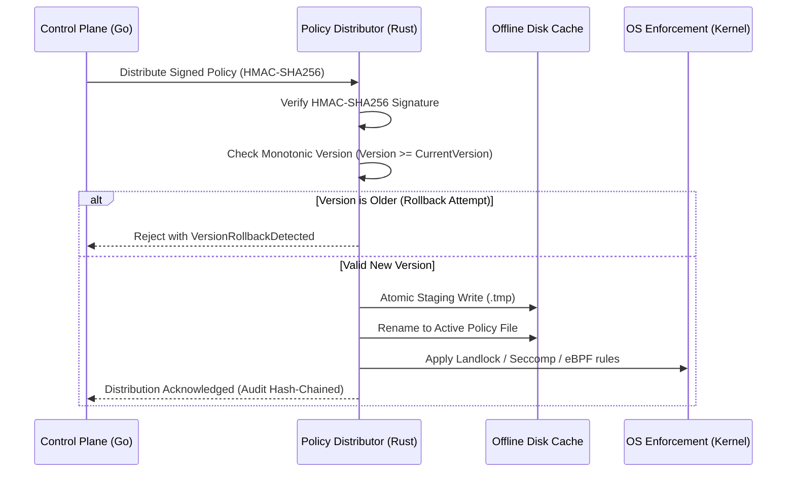

# Signed Policy Distribution & Anti-Rollback Architecture

## 1. Distribution Pipeline

BADGER uses a cryptographically verified, anti-rollback distribution pipeline to push policies from the Control Plane to host agents and local workload sandboxes:

---

## 2. Anti-Rollback Invariant

To defeat downgrade attacks where an adversary attempts to re-deploy a compromised older policy:
1. Every policy carries an integer `version` field.
2. The agent maintains an immutable high-water mark of the latest active version per policy ID.
3. Any policy update with `new_version < active_version` is unconditionally rejected by `badger-policy::distributor`.

---

## 3. Atomic Staging & Rollback Stack

- **Atomic Staging**: Files are written to `<cache_dir>/<policy_id>.tmp` and atomically moved to `<cache_dir>/<policy_id>.json` using `fs::rename`, preventing partial reads during crashes.
- **Rollback Stack**: The previous version is maintained in an in-memory and on-disk rollback stack. If a new policy causes sensor degradation or operator-triggered emergency rollback, the previous known good policy is restored instantly.
- **Offline Resilience**: Host nodes can reboot without network access to the Control Plane by loading the verified active policies directly from the local offline cache.
